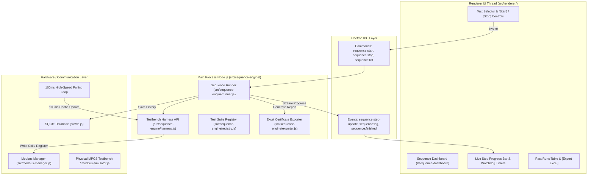

# Action Sequence Engine Architectural Plan & Implementation Specification

> **Status:** Approved Architecture (Post Grill-Me Session)  
> **Source Specification:** [`docs/manuals/mpcs_test_simulation_en.md`](../docs/manuals/mpcs_test_simulation_en.md)  
> **Target Equipment:** Indian Railways WAG-5 Electric Locomotive MPCS (Medha / Stesalit / Autometers)  
> **Compliance:** RDSO Specification `ELRS/SPEC/MPC-FDS/001`  

---

## 1. Executive Summary & Design Decisions

The Action Sequence Engine provides automated Hardware-in-the-Loop (HIL) simulation and acceptance testing for locomotive MPCS units. Based on the grill session, the architecture adheres to these core decisions:

1. **Execution Runtime (Main Process):** The test runner runs in the Electron Main process (`src/sequence-engine/`) for microsecond timer determinism, non-blocking UI rendering, and direct in-memory Modbus communication via [`src/modbus-manager.js`](../src/modbus-manager.js:10).
2. **Developer-Authored Test Modules:** Test sequences are maintained by developers as clean JavaScript modules in [`src/sequences/`](../src/sequences/) utilizing a standard `Testbench` harness API (`bench.set`, `bench.pulse`, `bench.expect`, `bench.wait`, `bench.assert`).
3. **Positive & Negative Test Coverage:** Every subsystem includes both "Happy Path" (Positive) test cases and "Fault Injection / Watchdog Trip" (Negative) test cases.
4. **High-Speed Hardware Polling (100 ms):** During sequence execution, active register polling accelerates to 100 ms to ensure watchdog timing windows (such as the 1.0s contactor feedback or 4.0s DJ closing window) are asserted with low jitter.
5. **Operator-Centric UI:** Technicians use a dedicated UI in [`src/renderer/index.html`](../src/renderer/index.html:1578) (`#sequence-dashboard`) to select and run either individual subsystem tests or the full master commissioning suite, with live step highlighting, countdown timers, and clear pass/fail status.
6. **Safety Teardown:** Automatic safe de-energization (driving all driver outputs to 0V) on test completion, failure, or emergency abort, with an optional "Debug Freeze on Failure" toggle.
7. **Traceability & Reports:** Every test run is logged in SQLite (`sequence_run_history`), and a read-only Excel (`.xlsx`) test certificate is generated via `exceljs` adhering to [`docs/adr/0002-manual-dashboard-local-export-and-test-provenance.md`](../docs/adr/0002-manual-dashboard-local-export-and-test-provenance.md).

---

## 2. System Architecture



---

## 3. The Testbench Harness API (`src/sequence-engine/harness.js`)

Each test sequence file interacts with the testbench through an instantiated `bench` object:

```javascript
class TestbenchHarness {
  /**
   * Set a digital or analog signal to a specific value.
   * Resolves signal tag (e.g. "I-00") to physical Modbus address.
   */
  async set(signalTag, value) {}

  /**
   * Pulse a digital input High (1) for durationMs, then automatically revert to Low (0).
   */
  async pulse(signalTag, value, durationMs) {}

  /**
   * Wait for durationMs without blocking the event loop.
   */
  async wait(durationMs) {}

  /**
   * Read the latest polled value of a signal from the real-time cache.
   */
  async read(signalTag) {}

  /**
   * Poll and assert that an MPCS output achieves expectedValue within timeoutMs.
   * @param {string} signalTag - Output signal tag (e.g. "O-00", "O-28")
   * @param {number} expectedValue - 1 or 0
   * @param {Object} options - { within: number, desc: string, pollIntervalMs?: number }
   */
  async expect(signalTag, expectedValue, options = {}) {}

  /**
   * Assert an arbitrary JavaScript condition. If false, throws an AssertionFailure.
   */
  assert(condition, failureMessage) {}

  /**
   * Log a milestone message streamed to UI and test certificate.
   */
  log(message) {}
}
```

---

## 4. Test Suite Inventory

The following 10 discrete test cases and 1 master suite will be implemented in [`src/sequences/`](../src/sequences/):

| Test ID | Sequence Name | Test Type | Target Subsystem & Purpose | Pass Criteria |
| :--- | :--- | :---: | :--- | :--- |
| **TS-00** | **Master Full Commissioning Suite** | Positive | Full 10-step lifecycle (Steps 1 to 10) | All steps 1–10 pass within timing constraints. |
| **TC-01** | Cab Activation & Diagnostics | Positive | Presets 21 inputs, sets Battery 110V, BL Key + BL1 | `O-28` (LSDJ) ON, MPCS boots clean. |
| **TC-02** | Pantograph Raising | Positive | Sets ZPT1, Catenary 25kV, injects `I-63` (<1s) | `O-02` (VEPT1) ON, no no-volt trip. |
| **TC-03** | Arno Starting & DJ Closing | Positive | BLDJ, pulses BP1DJ (2s), injects `I-35` + `I-18` (<4s) | `O-01` OFF, `O-28` (LSDJ) OFF, DJ sustained. |
| **TC-04** | Staggered Blower Acceleration | Positive | Injects `I-04` (+2s), `I-02` (+5s), `I-03` (+8s) | `Q118` timer (5.6s) satisfied, DJ remains closed. |
| **TC-05** | Direction & Notch-1 Progression | Positive | Reverser FOR, `I-30`/`I-31` sync, pulses `MP+` (1s), drops `I-19`, asserts `I-61` (<1s) | `O-26`/`O-27` pick up, Notch 1 confirmed. |
| **TC-06** | VCD Normal Cycle (Reset) | Positive | 60s idle $\rightarrow$ `O-79`/`O-78` fire $\rightarrow$ pulse `I-126` within 8s | Warnings clear immediately, DJ remains closed. |
| **TC-07** | DJ Watchdog Trip (Missing FB) | Negative | Pulses BP1DJ, **withholds `I-35` feedback** | MPCS trips `O-00` within 4.0s (Pass on Trip). |
| **TC-08** | Compressor Feedback Fault | Negative | Closes DJ, **withholds `I-18` feedback** | MPCS flags "MCP Fail" and sounds hooter. |
| **TC-09** | Blower Airflow Failure (`Q118`) | Negative | Closes DJ, **delays blower feedback past 5.6s** | `Q118` timer trips DJ breaker within 5.6s. |
| **TC-10** | VCD Penalty Brake Trip | Negative | 60s idle $\rightarrow$ 8s warning $\rightarrow$ **no reset pulse** | `O-77` (EM Valve) energizes at 68s, DJ trips. |

---

## 5. UI Layout & Operator Workflow (`#sequence-dashboard`)

1. **Header Toolbar:**
   - Test Scenario Dropdown (grouped into *Commissioning Suite*, *Subsystem Tests*, *Safety & Fault Injection*).
   - `[ ▶ Run Sequence ]` (Green) and `[ ⏹ Abort / E-Stop ]` (Red).
   - Checkbox: `[ ] Freeze hardware state on failure (Debug Mode)`.
2. **Active Execution Panel:**
   - Overall Progress Bar (`Step 4 / 8`).
   - Elapsed Test Time vs Estimated Duration.
   - Active Step Card with real-time countdown badge (e.g., *"Awaiting O-28 de-energize: 1.8s / 4.0s"*).
3. **Execution Audit Table:**
   - Live streaming rows: Step # | Description | Stimulus | Target | Response Time | Status (🟢 PASS / 🔴 FAIL / 🟡 ACTIVE).
4. **Verdict Banner:**
   - Large prominent banner at completion: `TEST PASSED` or `TEST FAILED: Step 5 Timeout`.
   - `[ 📄 Export Test Certificate (.xlsx) ]` button.

---

## 6. Implementation Roadmap

- **Phase 1: Database & Engine Core**
  - Add `sequence_run_history` table in [`src/db.js`](../src/db.js:10).
  - Implement [`src/sequence-engine/harness.js`](../src/sequence-engine/harness.js:1) and [`src/sequence-engine/runner.js`](../src/sequence-engine/runner.js:1).
  - Update [`src/main.js`](../src/main.js:240) to switch to 100ms polling when sequence is active.
- **Phase 2: Test Suite Definitions**
  - Implement all 10 test cases in [`src/sequences/`](../src/sequences/) following the translated manual [`docs/manuals/mpcs_test_simulation_en.md`](../docs/manuals/mpcs_test_simulation_en.md).
- **Phase 3: UI Implementation**
  - Build the sequence dashboard in [`src/renderer/index.html`](../src/renderer/index.html:1578) and wire event listeners in [`src/renderer/renderer.js`](../src/renderer/renderer.js:868).
  - Connect IPC channels in [`src/preload.js`](../src/preload.js:13) and [`src/main.js`](../src/main.js:1301).
- **Phase 4: Excel Certificate Exporter**
  - Implement [`src/sequence-engine/exporter.js`](../src/sequence-engine/exporter.js:1) using `exceljs` adhering to ADR 0002.
- **Phase 5: Verification & E2E Testing**
  - Create automated tests in `tests/sequence-engine.test.js` using [`tests/modbus-simulator.js`](../tests/modbus-simulator.js:1) to verify all positive and negative test cases pass deterministically.
